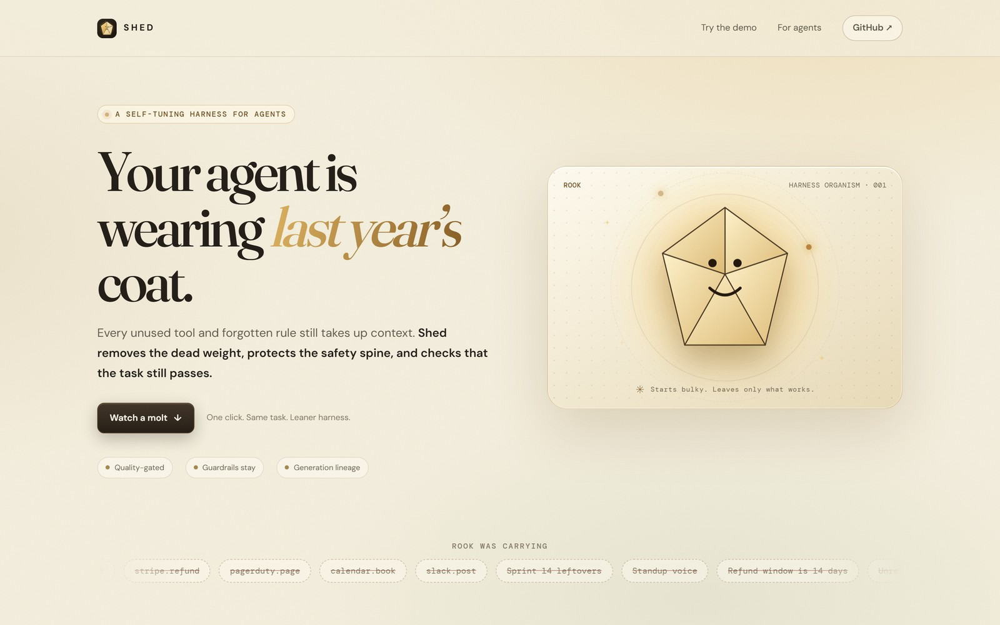
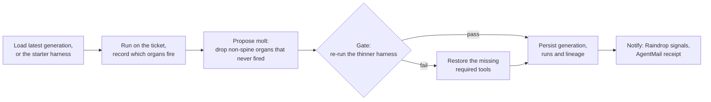

<p align="center"></p>
<h1 align="center">Shed</h1>
<p align="center"><b>Agents molt.</b> Shed drops the tools, rules and memories a task never uses, keeps the guardrails, and checks the job still passes.</p>
<p align="center">
  <a href="https://shed-molt.fly.dev">Live demo</a> ·
  <a href="#how-it-works">How it works</a> ·
  <a href="#use-it">Use it</a> ·
  <a href="#run-locally">Run locally</a>
</p>
<p align="center">
  <a href="https://github.com/elsisiem/shed/actions/workflows/ci.yml"></a>
  
  
</p>
<p align="center"></p>

## Why

Your agent is wearing last year's coat. Agent harnesses only grow: every tool, rule and memory that was useful once stays in the context window, and every run pays for all of it. Shed watches which parts of a harness a task actually uses and sheds the rest. A protected **spine** of guardrails is never removed, and a deterministic quality gate re-runs the thinner harness before it is kept. Every generation is stored with its parent, so you can see what was shed and when.

Rook is the demo agent: a security-triage bot that started life as a kitchen sink. Jira, PagerDuty, Stripe refunds, a weather forecast and a note about a roommate's HDMI cable all came along. Each molt, Rook gets leaner and a little more pleased with itself.

## How it works

An **organ** is any piece of a harness: a tool, rule, policy, memory or guardrail. The **spine** is the set of guardrail organs that always stay. A **generation** is one version of the harness, and each molt produces the next.



- **Run.** A non-spine organ fires when the ticket text contains one of its keywords. Spine organs always fire. `runHarness` in `src/molt.ts`.
- **Propose.** The next generation keeps the spine and the organs that fired. On the first molt, Exa can add organs seeded from live web sources. `proposeMolt` in `src/molt.ts`, `src/exa.ts`.
- **Gate.** The thinner harness runs again. The task passes only if the three required tools (`github.get_issue`, `severity.classify`, `draft.reply`) fire. If one was cut, it is restored from the parent. `gateMolt` in `src/molt.ts`.
- **Persist.** Both harnesses, both runs and a lineage record (parent, dropped ids, tokens saved) are saved. `src/cycle.ts`, `src/db.ts`.
- **Notify.** Optional Raindrop signals and an AgentMail receipt. A failure here is reported in the response and does not fail the molt. `src/raindrop.ts`, `src/mail.ts`.

On the demo ticket, with no integrations configured, the first molt takes the starter harness from 17 organs and 2,360 estimated tokens per run to 6 organs and 800 (66% less). The gate passes before and after. A second molt finds nothing more to shed and continues from generation 1.

## Use it

Open the [live demo](https://shed-molt.fly.dev) and press **Molt the harness**, or call the API:

```sh
curl -s -X POST https://shed-molt.fly.dev/v1/demo \
  | jq '{gen: .after.generation, dropped: [.dropped[].title], savedTokens, savedPct, quality: .nextRun.quality}'
```

| Method | Route | Description |
| --- | --- | --- |
| `GET` | `/healthz` | Process health |
| `GET` | `/v1/status` | Which integrations are configured, for example `{"mongo":false,"exa":false,...}` |
| `POST` | `/v1/demo` | Run the canned molt and persist generations, runs and lineage. Optional `{"sessionId":"<UUID>"}` isolates a fresh lineage |
| `GET` | `/v1/harness/:agent/:task` | Latest harness, or the starter harness. Try `rook/github.security.triage` |
| `GET` | `/v1/lineage?agent=rook&task=github.security.triage` | Saved generations and molt lineage |
| `POST` | `/v1/speak` | Rook audio as `audio/mpeg`. Returns 503 without an ElevenLabs key |
| `GET` | `/llms.txt` | Agent-facing integration summary |

`POST /v1/demo` returns `before` and `after` (harnesses), `run` and `nextRun`, `dropped`, `kept`, `savedTokens`, `savedUsd`, `savedPct`, `warnings`, `mail`, and a one-line `line` for Rook to speak.

## Run locally

Prerequisite: Node 22.

```sh
npm ci
cp .env.example .env   # every variable is optional
npm run check          # typecheck and tests
npm run dev            # http://localhost:8080
```

Open the page and click **Molt the harness**. The first run sheds unused organs, later runs continue from the saved generation, and **Reset demo** starts a fresh lineage.

## Configuration

Copy `.env.example` to `.env` (git-ignored). Every variable is optional. Without `MONGODB_URI`, data lives in memory.

| Variable | Required | Purpose |
| --- | --- | --- |
| `MONGODB_URI` | No | Durable generations, runs and lineage in the `shed` database. Unset or unreachable means in-memory storage |
| `EXA_API_KEY` | No | Seeds extra organs from live web sources on the first molt |
| `AGENTMAIL_API_KEY` | No | Emailed molt receipts |
| `AGENTMAIL_INBOX` | No | Inbox the receipt is sent from. Receipts are skipped without it |
| `MOLT_NOTIFY_TO` | No | Receipt recipient. Defaults to `AGENTMAIL_INBOX` |
| `RAINDROP_WRITE_KEY` | No | Run events and token-savings signals |
| `RAINDROP_PROJECT` | No | Raindrop project id. Default `shed` |
| `ELEVENLABS_API_KEY` | No | Spoken receipts from `POST /v1/speak` |
| `ELEVENLABS_VOICE_ID` | No | Voice id. Defaults to a built-in voice |
| `PORT` | No | Listen port. Default 8080 |
| `PUBLIC_URL` | No | Read by `src/env.ts`, not used by any route yet |

Storage is MongoDB when `MONGODB_URI` is set and reachable, and in-memory otherwise. The public demo currently runs in memory, so lineage resets on restart. For Atlas, allow the app host under Network Access, then confirm `GET /v1/status` reports `"mongo": true`.

## Deploy

1. Install `flyctl` and run `fly auth login`.
2. Pick a globally unique app name in `fly.toml`.
3. Set secrets with `fly secrets set MONGODB_URI=...` (never in `[env]`).
4. Run `fly deploy`.
5. Check `https://<your-app>.fly.dev/healthz`, run the demo, and confirm persistence with `GET /v1/lineage`.

## Project layout

```
src/server.ts    Hono server and HTTP API
src/cycle.ts     one full molt cycle
src/molt.ts      run, propose and gate
src/seed.ts      starter harness and demo ticket
src/db.ts        MongoDB storage with in-memory fallback
src/exa.ts       optional live seeding
src/mail.ts      optional AgentMail receipt
src/raindrop.ts  optional signals
src/voice.ts     optional ElevenLabs audio
public/          the demo site (static HTML, CSS, JS) and llms.txt
test/            vitest suite
```

## Status

- Shed is a prototype, not a general prompt optimizer. The demo uses one fixed GitHub security-triage ticket, keyword-based organ activation and a deterministic pass or fail gate.
- Token and dollar figures are illustrative estimates at $3 per million tokens. They are not measured provider billing.
- The public demo runs without MongoDB (`/v1/status` reports `"mongo": false`), so lineage lives in memory and resets on restart. The Fly machine also stops when idle.
- The 6 tests cover the molt engine and the cycle, using in-memory storage. The MongoDB path and the optional integrations are not exercised in CI.

## License

MIT. See [LICENSE](LICENSE).
